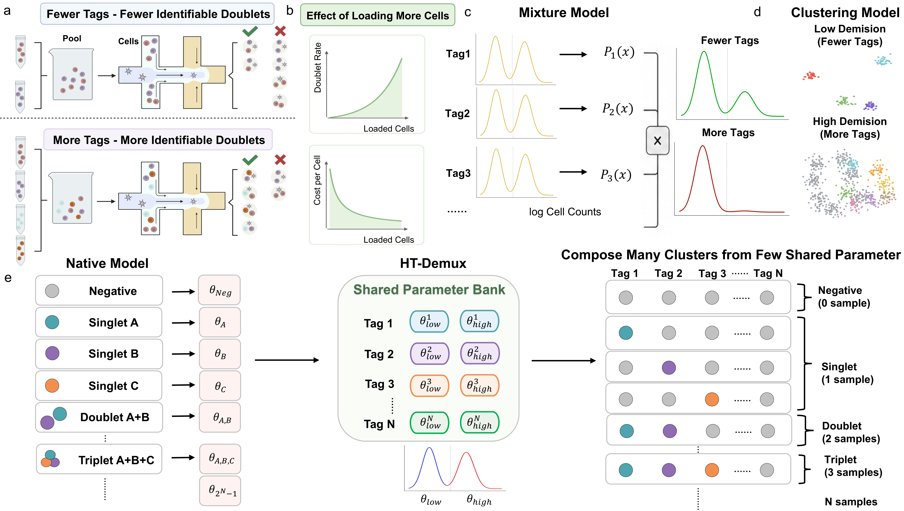

# HT-Demux

HT-Demux is a scalable sample demultiplexing framework for high-throughput hashtag-based single-cell sequencing experiments. It is designed for HTO/CMO-style multiplexed single-cell data, where each droplet or cell barcode contains a vector of sample-tag counts.

HT-Demux models sample-tag signals with shared positive and negative components and performs posterior-based assignment over singlet and multiplet configurations. This design allows the method to assign droplet-level sample identities, identify multiplets, and mark low-confidence droplets as unassigned.

<p align="center">
  
</p>

<p align="center">
  <b>Figure 1.</b> Overview of the HT-Demux framework for scalable sample demultiplexing in high-throughput single-cell sequencing.
</p>

## Installation

Clone the repository:

```bash
git clone https://github.com/Mcx723/HT-Demux.git
cd HT-Demux
```

Create a Python environment:

```bash
conda create -n htdemux python=3.10
conda activate htdemux
```

Install required packages:

```bash
pip install numpy pandas scipy scikit-learn torch matplotlib seaborn jupyter
```

## Input format

HT-Demux uses a 10x-style matrix directory containing:

```text
matrix.mtx or matrix.mtx.gz
barcodes.tsv or barcodes.tsv.gz
features.tsv or features.tsv.gz
```

## Quick start

A typical HT-Demux workflow consists of four steps:

1. Load a 10x-style HTO matrix.
2. Build singlet and multiplet configurations.
3. Fit the HT-Demux model.
4. Convert posterior probabilities into final droplet assignments.

Example:

```python
from pathlib import Path
import pandas as pd

from preprocess import DemuxManager
from classifier import HTClassifier

# Input directory
data_dir = Path("path/to/hto_matrix")

mtx_path = data_dir / "matrix.mtx"
features_path = data_dir / "features.tsv"
barcodes_path = data_dir / "barcodes.tsv"

# Load data
manager = DemuxManager()

counts, barcodes = manager.load_10x_mtx(
    mtx_path=mtx_path,
    features_path=features_path,
    barcodes_path=barcodes_path
)

# Build singlet and multiplet configurations
manager.build_configs(max_klet=2)

# Run demultiplexing
result = manager.run_demux(
    counts=counts,
    model_type="NB",
    method="EM",
    device="cpu"
)

# Convert posterior probabilities to final labels
classifier = HTClassifier(
    cfg_labels=result["cfg_labels"],
    tag_names=result["tag_names"],
    configs=manager.configs
)

assignment_df = classifier.classify(
    posteriors=result["posteriors"],
    barcodes=barcodes,
    map_thresh=0.9
)

assignment_df.to_csv("htdemux_assignments.csv", index=False)
```

## Output

HT-Demux produces a droplet-level assignment table.

Typical output columns include:

```text
barcode
assignment_raw
assignment
assignment_final
probability
p_<HTO name>
```

Column descriptions:

| Column | Description |
|---|---|
| `barcode` | Droplet or cell barcode |
| `assignment_raw` | Maximum-posterior configuration |
| `assignment` | Interpreted assignment before confidence filtering |
| `assignment_final` | Final label after confidence filtering |
| `probability` | Maximum posterior probability |
| `p_<HTO name>` | Marginal posterior probability for each sample tag |

Typical final labels include:

```text
Sample / HTO name
Multiplet
Unassigned
```

## Model options

HT-Demux supports different model and optimization choices:

```python
result = manager.run_demux(
    counts=counts,
    model_type="NB",
    method="EM",
    device="cpu"
)
```

Common options:

| Option | Description |
|---|---|
| `model_type="NB"` | Negative Binomial model for raw count-like HTO data |
| `model_type="GMM"` | Gaussian mixture-style model for transformed signal data |
| `method="EM"` | Expectation-maximization-style optimization |
| `method="GD"` | Gradient-based optimization |
| `device="cpu"` | Run on CPU |
| `device="cuda"` | Run on GPU if available |

For raw UMI-like HTO counts, `model_type="NB"` is recommended.  
For log-transformed or approximately Gaussian HTO signals, `model_type="GMM"` may be used.

## Synthetic data generation

The repository includes a simulator for generating synthetic HTO multiplexing datasets.

See:

```text
Simulator.ipynb
```

This notebook demonstrates how to generate synthetic droplet-level HTO matrices with known ground-truth sample compositions.

## Example workflow

For an end-to-end example, see:

```text
HT_Demux.ipynb
```

This notebook demonstrates how to load data, run HT-Demux, compute posterior probabilities, and export final assignments.

## Evaluation

If ground-truth labels are available, predictions can be evaluated using the provided evaluation utilities.

Example:

```bash
python evaluator.py \
    --pred htdemux_assignments.csv \
    --truth ground_truth.csv
```

The ground-truth file should contain droplet-level labels such as singlet identity, multiplet status, or sample composition.

## Citation

If you use HT-Demux in your work, please cite:

```text
HT-Demux: scalable sample demultiplexing in ultra-high-throughput scRNA-seq.
https://github.com/Mcx723/HT-Demux
```

## Contact

For questions, issues, or suggestions, please open an issue on GitHub:

```text
https://github.com/Mcx723/HT-Demux/issues
```


## Current shared-inference and benchmark options

The existing model modules also expose `DiscreteLogNormalCluster` (in
`models.base_cluster`) and `FactorizedSharedCluster` / `fit_factorized_em`
(in `models.optimizer`). No extra model files are required. NB shared EM updates
both component means and weighted maximum-likelihood dispersion parameters.
Large tag spaces can use implicit all-order configurations instead of materializing
all tag subsets. `model_type="auto"` compares supported count-emission families
using likelihood-based BIC without reference labels.

A command-line entry is available in `benchmark/HTDemux.py`:

```bash
PYTHONPATH="$PWD" python benchmark/HTDemux.py \
  --input-dir /path/to/10x_hto_matrix \
  --output-dir /path/to/output \
  --model-type auto --configuration-prior auto --max-iter 100
```

The classifier supports joint, posterior, hierarchical and marginal decision modes.
The benchmark CLI defaults to hierarchical decisions with multiplet prior odds
scaled by 0.5; `--multiplet-prior-scale 1` disables that calibration in the modes
where it applies. These settings are configurable assumptions, not estimates of
known truth. `--signal-shape-min` and `--init-tail-fraction` control the NB signal
shape bound and optional initialization tail. Run `--help` for the full interface.

Benchmark scripts now include `CMDdemux.R`, `deMULTIplex2.R` and `HTDemux.py`.
The demuxmix implementation is `benchmark/demuxmix.R`; the older
`benchmark/demumix.R` remains a compatibility entry. R wrappers accept
`BENCH_INPUT_DIR` and `BENCH_OUTPUT_DIR`; other options and strict-default modes
are documented in each script. HashSolo uses its Scanpy interface, and GMM-Demux
uses its own `GMMD_INPUT_DIR` / `GMMD_OUTPUT_DIR` variables. Install comparator
packages in their corresponding Python/R environments before running them.

Experiment outputs are written to the selected output directories. This code
update does not include simulation matrices, fitted results, manuscript figure
notebooks, runtime tables, or other local research data.
